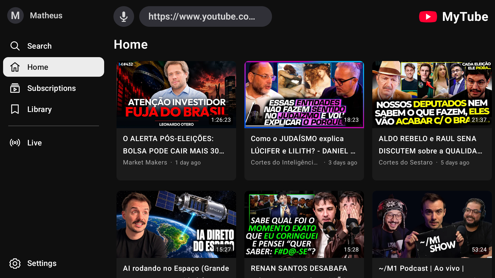
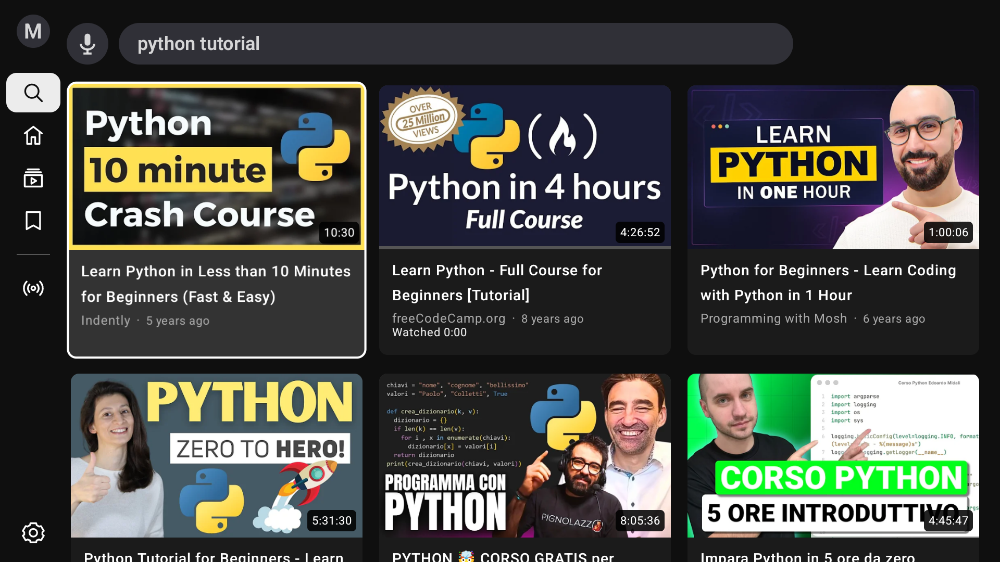
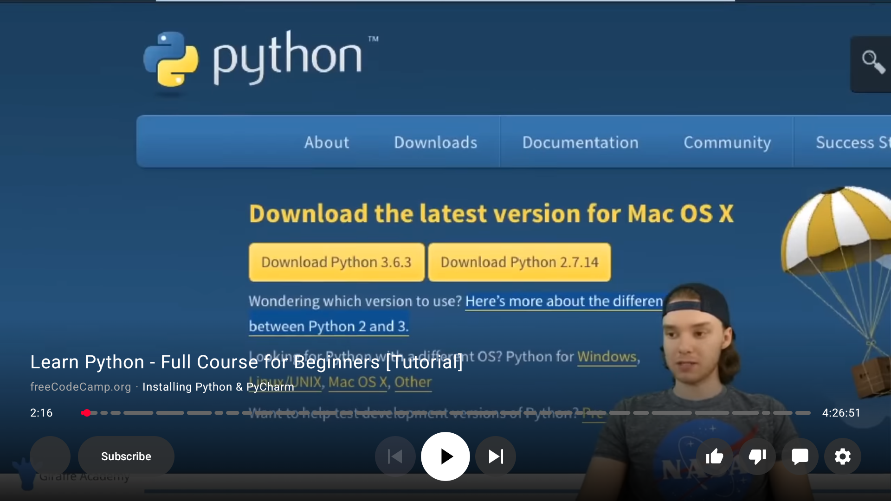
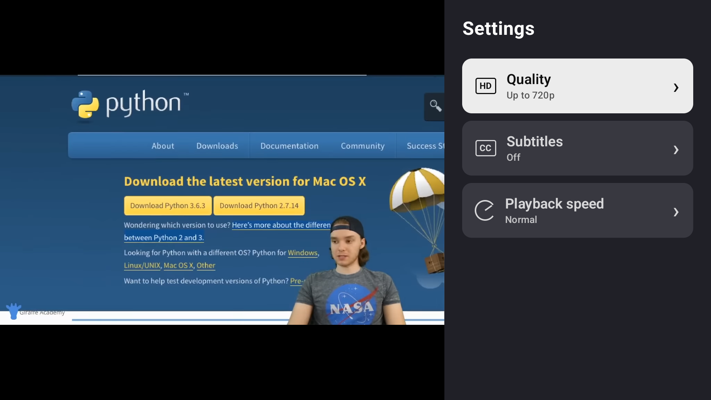
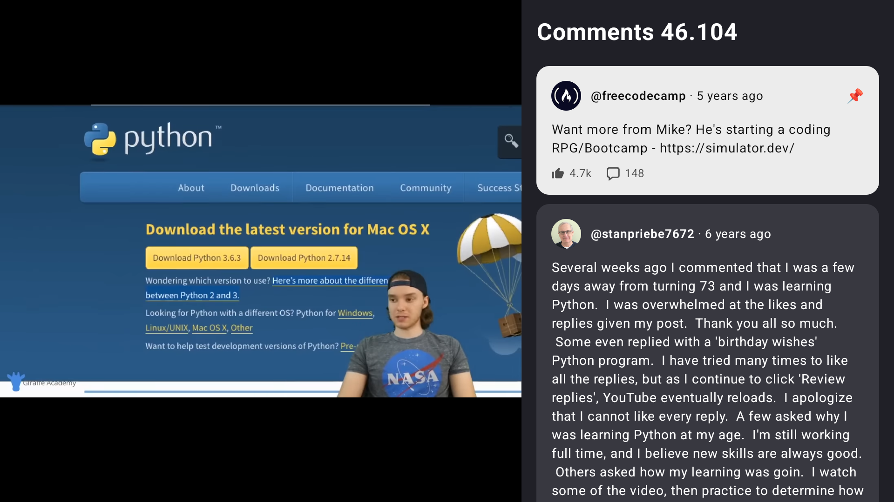
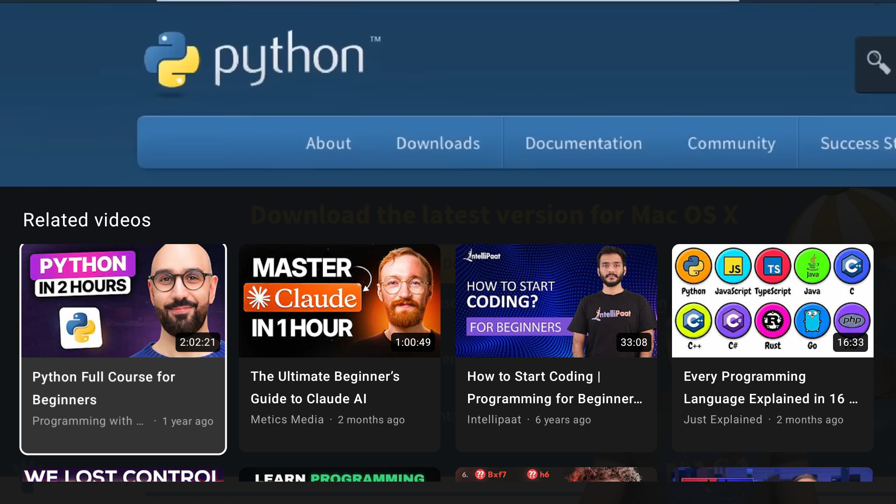

# MyTube

**An ad-free, open-source YouTube client for Google TV and Android TV.**

MyTube started with a simple frustration: being tired of YouTube ads interrupting videos. The goal is a familiar, comfortable TV experience where you choose what to watch, keep your library on your own device and contribute improvements in the open. Everyone is welcome to help with code, design, accessibility, testing, translations and documentation.

MyTube is an independent client, not Google's official YouTube app or an open-source release of Google's code. It is free software under **GPL-3.0-or-later**.

## Preview

Actual MyTube screenshots, captured on a Chromecast. Click an image to view it at full size.

[](docs/images/home.png)

| Search and recommendations | Player with video chapters |
| --- | --- |
| [](docs/images/search.png) | [](docs/images/player-chapters.png) |
| **Playback settings** | **Comments** |
| [](docs/images/settings.png) | [](docs/images/comments.png) |

**Related videos below the player**

[](docs/images/related-videos.png)

The Search preview shows MyTube 0.13.0; the other previews show 0.10.0. The player, settings, comments and related-video views include actual decoded frames from the same Python course. A test-only capturable video surface was used for these four screenshots; [capture details and how to add previews](docs/images/README.md).

## What you can do

- Watch extracted video streams without YouTube's inserted ad breaks. Creator sponsorships embedded in a video remain; SponsorBlock is not currently integrated.
- Browse a mixed Home feed based on followed channels, saved interests/examples and local viewing history. Videos load in stable batches of ten.
- Search with an embedded remote-friendly keyboard, live text suggestions, recent searches or the system's voice recognizer.
- Follow channels locally, browse circular subscription cards, find currently live videos and keep a local watch history.
- Start a video with one click; use bottom controls, related videos, chapter divisions, audio-language selection, captions, speed and quality settings.
- Resume partially watched videos, see red thumbnail progress and use the cancellable ten-second Up next countdown.
- Set a local profile name/photo without a Google account. No account sync, analytics SDK, ad SDK or required MyTube server is included.

Video requests, thumbnails, search terms and autocomplete still contact YouTube and its delivery services. Availability depends on upstream services and NewPipeExtractor. [Detailed feature behavior](docs/FEATURES.md).

## No login required — your library stays with you

**You do not need to log in or provide any personal information to use MyTube.** No Google account, email, password, name or profile photo is required. The local profile name/photo is entirely optional.

Your subscriptions, watch history, viewing progress, interests and local reactions are stored on your own Android device. There is no MyTube account or cloud library synchronization. App updates with the same signing key preserve that library; uninstalling the app or clearing its storage deletes it.

Because MyTube does not sign in to Google, it does not import your YouTube subscriptions, watch history or personalized Google recommendations. **Fine-tune your own video preferences** to make Home more relevant:

1. Follow the channels you enjoy using **Subscribe** in the player or the channel actions on a video.
2. Save topics/search phrases in **Settings → Manage interests & channels**.
3. Long-press a video and choose **Use for suggestions** to save it as an example of what you like.
4. Use local likes/dislikes and **Not interested** to refine your choices. Local watch history also supplies recommendation examples.

Saved choices influence the candidate videos and channel mix; this is MyTube's local recommendation process, not your Google account's feed. Start with a few favorite channels and topics, then adjust them as you explore. Ordinary playback, metadata, thumbnail and search/autocomplete requests still reach YouTube and its delivery services; keeping your library local does not make those requests anonymous.

## Start locally

This is a native Android app: run it on an **Android TV emulator or a Google TV/Android TV device**, not a localhost web server. Older cast-only Chromecast models without installable Android apps cannot run this APK.

Requirements: JDK 17+ (21 used for development), Android SDK platform 36, build-tools 36.0.0 and platform-tools/ADB. The repository includes the Gradle wrapper; no global Gradle, Node.js or Google API key is needed. Android minimum API is 24. The current app version is **0.13.0**.

First follow [Java, Android CLI and SDK setup](docs/DEVELOPMENT.md#1-install-java-and-the-android-tools). Then, from the checkout root:

```sh
./gradlew --no-daemon --console=plain testDebugUnitTest lintDebug assembleDebug
adb devices -l
```

Start a TV emulator or [connect your Chromecast](docs/DEVELOPMENT.md#3-connect-a-chromecast-or-google-tv). Use the exact serial from `adb devices -l`:

```sh
export MYTUBE_DEVICE="emulator-5554"  # Replace with your actual emulator/TV serial.
adb -s "$MYTUBE_DEVICE" install -r app/build/outputs/apk/debug/app-debug.apk
adb -s "$MYTUBE_DEVICE" shell am start -W -n app.mytube.tv/.MainActivity
```

Alternatively, Android CLI can install and launch the same APK:

```sh
android run --device "$MYTUBE_DEVICE" --apks app/build/outputs/apk/debug/app-debug.apk
```

The [development guide](docs/DEVELOPMENT.md) covers macOS/Linux/Windows paths, Android CLI commands, emulator creation, wireless pairing, multiple devices and connection troubleshooting. The Google tools are documented in [Android CLI](https://developer.android.com/tools/agents) and [ADB](https://developer.android.com/tools/adb).

## Install on Chromecast / Google TV

On a device with Wireless debugging, enable Developer options and choose **Pair device with pairing code**. The computer and TV must be on a network that lets them reach each other. Pair using the temporary pairing address shown on the TV:

```sh
adb pair TV_IP:PAIRING_PORT
# Enter the current six-digit code when prompted.
```

Return to the Wireless debugging main screen and use its **connection port**, which is different from the pairing port:

```sh
adb connect TV_IP:CONNECTION_PORT
adb devices -l
```

Select the resulting serial, then install and launch using the commands above. Do not reuse historical IPs, ports or pairing codes from someone else's setup. [Full connection and troubleshooting guide](docs/DEVELOPMENT.md#3-connect-a-chromecast-or-google-tv).

For an optimized local build:

```sh
./scripts/build.sh
adb -s "$MYTUBE_DEVICE" install -r artifacts/mytube-tv-0.13.0.apk
adb -s "$MYTUBE_DEVICE" shell am start -W -n app.mytube.tv/.MainActivity
```

APKs are generated locally under ignored `artifacts/`; a source checkout does not include prebuilt APKs. Current debug and release variants use your local Android development key. Updates preserve data when the signing key matches; a build from another computer may use a different key. Public release signing is not configured. Do not uninstall an existing app to work around a key mismatch without backing up and agreeing how to handle its local library.

Audio defaults to the original track when identified by the extractor. Use **Player Settings → Audio language** to choose another supplied track; the choice applies to that video and a new video returns to original-audio preference. Search results and Library history use vertical grids, and entering a channel from its avatar keeps you in that channel’s videos.

When browsing search results, the keyboard/suggestion editor collapses to give complete video cards room. Up from the first result row reopens the keyboard; focused rows stay aligned at the top of the result grid.

## Remote controls

| Action | Remote |
| --- | --- |
| Open a sidebar page | Focus its label; Enter is optional |
| Enter the page / return to sidebar | Right / Left from the first grid column |
| Play a video | Select its thumbnail |
| More video options | Long-press Select on a thumbnail |
| Progress bar / play-pause / related grid | Down, Down, then Down again |
| Return from related videos | Up through rows, then Up to controls |
| Return to progress / hide controls | Up from buttons / Up from progress |
| Seek with progress bar focused | Left/Right, ten seconds |
| Close a drawer or return | Back |

## For contributors and coding agents

Start with [AGENT.md](AGENT.md) for project context, source ownership and the development loop. [AGENTS.md](AGENTS.md) points agent tools to the same guide. Read the [constitution](CONSTITUTION.md), [architecture](docs/ARCHITECTURE.md) and [contribution guide](CONTRIBUTING.md) before making changes.

```sh
# Local checks; do not require a TV.
./gradlew --no-daemon --console=plain testDebugUnitTest lintDebug
# Full packaging gate: tests, debug/release lint and both APK variants.
./scripts/build.sh
```

Real UI/playback checks are opt-in and interact with the selected TV. Follow [device-test instructions](docs/DEVELOPMENT.md#5-verify-changes) to install test APKs in place and preserve the existing library. [Version 0.13 validation](docs/VALIDATION-0.13.md) records prior executed checks and their limits; it is not a guarantee for every device/video.

There is no Google account sync, casting receiver, download UI, SponsorBlock integration, dedicated Shorts page, chapter picker or seek-thumbnail preview yet. Comments are read-only. DRM/account-restricted content is unsupported. Google TV is the primary target; phone/touch behavior has not received equivalent testing.

## License and independence

[GPL-3.0-or-later](LICENSE). See [THIRD_PARTY_NOTICES.md](THIRD_PARTY_NOTICES.md) for dependency licenses, including NewPipeExtractor. MyTube does not bundle the official YouTube APK or Google application code. YouTube and creator media shown in previews remain the property of their respective owners.
